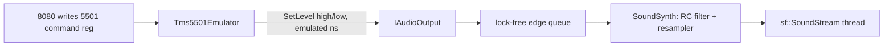

# Sound Plan

Status: phases 1 to 6 are implemented. Phase 7 (checking on real tones) is open. Sound is on by default and can be toggled from the Sound menu, Preferences or with Alt+A; volume and enable state persist in `~/.config/cc2emu/settings.config`.

Goal: play audio from the emulated Compucolor II through the SFML frontend.

## What the hardware does

The stock Compucolor II has no sound hardware. Sound comes from the third-party **SoundWare** add-on, which ccemu emulates (`emu/js/audio.js`):

- A small RC filter hangs on the serial port TXD pin and drives an amplifier and speaker.
- Software makes sound by toggling the TMS5501 **break** bit: discrete command register (write port `0x4`), bit 1. `1` forces the line low (space), `0` releases it.
- It only counts while the serial port is the selected device: output port `0x7` bits 5:4 equal `0`.
- Nothing else is needed. There are no sound registers and no sample data. Audio is a 1-bit signal whose edge times are the whole waveform.

The default drive A disk (`life.ccvf`, labelled "Life with Sound") uses this, which gives us a ready test program.

So the job has three parts: capture the edges with accurate timestamps, turn them into samples, and keep that stream in step with the sound card.

## Design

- **`IAudioOutput`** (new, `include/Compucolor/Common/`): `SetLevel(bool high, uint64_t emulatedNs)`, `Reset()`, `Close()`. It is passed to the plugin manager like `IDisplay`, so emulator libraries never depend on SFML.
- **Emulated clock:** edges need a timestamp in emulated time, not wall time. The CPU loop already counts cycles (502 ns each). Expose a monotonic emulated-nanosecond counter and let the TMS5501 read it through a small `IClock` interface.
- **`SoundSynth`** (new, app project, no SFML dependency): pure and unit-testable. It takes `(timestamp, level)` edges and produces float samples at the output rate. It models the RC low-pass filter. ccemu uses R = 1 kΩ and C = 0.04 µF, about 4 kHz.
- **`AudioOutput`** (new, SFML app): an `sf::SoundStream`, mono at the device rate. `onGetData` asks `SoundSynth` for the next block.
- **Where the break bit is read:** `Tms5501Emulator` command-register write (the `case 0x4` handler). Call `SetLevel` only when the bit changes and the serial port is selected. Also drive the level low on reset.

## Phases

### 1. Prerequisites
- Confirm the devcontainer's SFML 3.0.2 build includes the audio module (`libsfml-audio`) and add the `sfml-audio` dependency to the app target.
- Handle machines with no audio device: opening the stream must fail quietly and leave the emulator running.

### 2. Emulated clock
- Add the emulated-nanosecond counter to the CPU loop (cycles times 502, already computed in `StepOnce`) and expose it through a small interface that the TMS5501 receives from the plugin manager.
- Tests: counter advances by step cycles and stands still while paused.

### 3. Capture edges
- Add `IAudioOutput` and a no-op default so the TMS5501 works without a frontend.
- In the TMS5501, detect break-bit changes while the serial port is selected and forward them with the timestamp.
- Tests (with a mock audio output): toggling bit 1 sends alternating levels, no event when the bit is unchanged, no event when a floppy is selected, and the level resets to low on reset.

### 4. Synthesis
- Implement `SoundSynth`:
  - an edge queue (single producer, single consumer, no locks on the audio thread),
  - first-order RC filter stepped between edges with an exponential decay,
  - conversion from emulated time to the output sample rate (a DDA or fractional step, as ccemu does),
  - after a long idle gap, decay to silence instead of generating samples for the whole gap.
- Tests: a square wave at 1 kHz produces about 1 kHz (count zero crossings), the filter smooths a step, silence after idle, and an empty queue gives silence.

### 5. Playback and sync
The emulator runs against the wall clock and the sound card runs on its own clock, so they will drift. Approach, in order of effort:
1. Start simple: map emulated time to the sample position at stream start, drop edges that fall too far behind, and pad with silence when the stream runs ahead.
2. If there are audible glitches, add feedback like ccemu's `audioBoostCpu`: if the buffer is low, run the CPU about 2% fast; if high, about 2% slow. The pacing code in `CompucolorEmulator` (the wall-clock budget) is the place for this.
- In unregulated or paused mode, mute and flush the queue.

### 6. UI and settings (done)
- Settings keys `sound_enabled` (on by default here) and `sound_volume` (0-100).
- Sound menu with enable toggle and volume slider, Preferences section with the same controls, and Alt+A hotkey.
- Persist through `Settings`, apply at startup and update live while running.

### 7. Verify on the real thing
- Run `life.ccvf` and check for tones, correct pitch and no clicks at start or stop.
- Check pause, reset, window recreate (fullscreen toggle) and quit.

## Risks and open questions
- **Bit meaning:** ccemu forces TXD low with bit 1 set. Confirm the phase does not matter, since the filter output is the same shape either way, but double check against a real tone program.
- **Latency:** `sf::SoundStream` buffers; expect 50 to 100 ms. Fine for games, noticeable for typing feedback.
- **Drift handling** is the hardest part. Phase 5 is deliberately staged so a simple version ships first.
- **Threading:** the audio thread must never block on the emulator thread. Use the lock-free queue and atomics only.
- **Headless/CI:** audio is not touched by the unit tests, which cover `SoundSynth` and the TMS5501 hook only.
